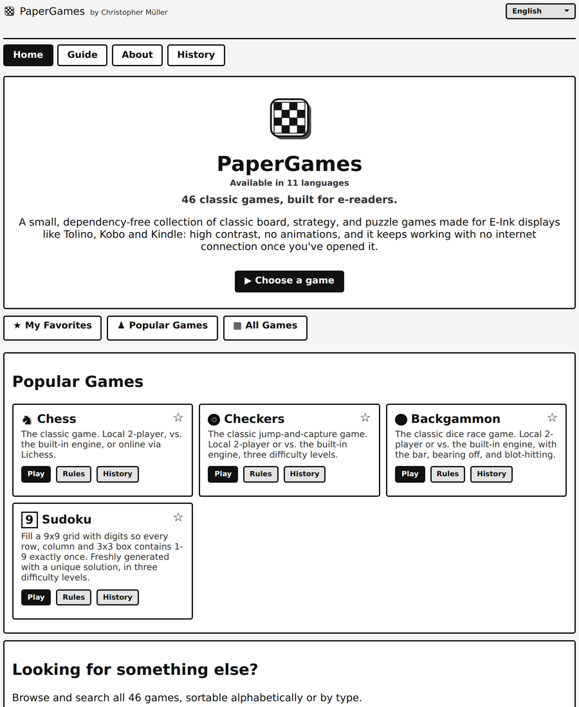

# PaperGames

A collection of 103 classic board, strategy, and puzzle games as a single
offline-capable web app, designed to be readable and usable on e-paper /
e-ink displays (high contrast, no animation-dependent UI, works without a
live network connection once loaded). Play at
[yourchaoschris.github.io/PaperGames](https://yourchaoschris.github.io/PaperGames/).

Every game is playable against a built-in AI opponent, entirely client-side.
Chess additionally supports playing real opponents online via a
[Lichess](https://lichess.org) account connection (OAuth) — PaperGames is not
affiliated with, endorsed by, or connected to Lichess in any way.

Free, no ads, no account, no tracking — everything runs and is stored
locally in your browser. Once a page has loaded once, it keeps working with
no internet connection at all.

## Games

- Chess
- Go
- Checkers
- Royal Game of Ur
- Nine Men's Morris
- Backgammon
- Xiangqi (Chinese Chess)
- Mancala
- Reversi
- Four in a Row
- Gomoku
- Senet
- Shogi (Japanese Chess)
- Sudoku
- Peg Solitaire
- Minesweeper
- Nonograms
- 2048
- Yatzy
- Light Switch
- Mahjong Solitaire
- FreeCell
- Card Tactics
- Hnefatafl
- Wall Maze
- Hex
- Halma
- Bulls and Cows
- Dots and Boxes
- Klondike
- Amazons
- Kakuro
- Fanorona
- Chinese Checkers
- Spider Solitaire
- Bagh-Chal
- Tablut
- Marble Push
- Pyramid Solitaire
- Surakarta
- Hashiwokakero
- Fleet Battle
- Skyscrapers
- Konane
- Slitherlink
- Ludo
- Categories (Stadt, Land, Fluss) - a game-master helper for the pen-and-paper word game
- Domino
- Mau Mau
- Calcudoku
- No Neighbors
- Killer Sudoku
- Thirty-One (Schwimmen)
- Durak
- Concan
- Doppelkopf
- Trix
- Crate Pusher

## Languages

The interface is available in 12 languages:

- English
- German (Deutsch)
- French (Français)
- Spanish (Español)
- Italian (Italiano)
- Dutch (Nederlands)
- Polish (Polski)
- Ukrainian (Українська)
- Russian (Русский)
- Japanese (日本語)
- Chinese (中文)
- Arabic (العربية) - everything except the legal pages, which stay in English (the German/English versions are binding)

## Technology

Plain HTML, CSS, and JavaScript — no build step, no framework, no backend.
Game state, settings, and stats are kept in the browser's `localStorage` /
`sessionStorage`. A service worker (`sw.js`) precaches the whole app shell on its
first install, so every game keeps working offline afterwards,
including ones that have never been opened. The home page shows
whether that has finished.

## Requirements

PaperGames needs a current browser. There is no build step and there are
no polyfills, so the browser itself must support:

- JavaScript ES2015 (`const`, arrow functions, classes, Promises)
- `fetch`
- CSS Flexbox
- CSS variables (custom properties)
- Service workers, for offline play

On a browser without ES2015, Promises or `fetch`, every page shows a short
note in English and German ("Your browser is too old for PaperGames")
instead of the games. The check is the first script of every page
(`tools/old-browser.js`, inserted by `tools/seo.js`) and is itself plain
ES5.

Devices:

- **Tested** (someone reported back; the list on
  [Tested devices](https://yourchaoschris.github.io/PaperGames/devices.html)
  is the reference): PocketBook Era, Tolino Vision Color, Boox Go 7,
  Tolino Vision 6.
- **Not tested**: every other device, including the newer Kindle browser
  (from firmware 5.16.4; its engine is not documented) and older Tolino
  readers (Android 4.1; browser version not documented).
- **Does not run, according to the sources** (not tried on a device): the
  older Kindle browser (WebKit from about 2009, ES5 only, no `fetch`, no
  Promises, no Flexbox) and the Kobo browser based on Qt WebKit 538.1.

Sources: [documentation for the Kindle browser](https://thorgalle.me/notes/documentation-for-the-kindle-browser)
(older Kindle browser), the-ebook-reader.com (7 Nov 2023, newer Kindle
browser from firmware 5.16.4), MobileRead (2019, Kobo Qt WebKit 538.1),
goodereader.com (Tolino: older devices Android 4.1, Vision 6 Android 8.1).

## License

PaperGames is licensed under the
[PolyForm Noncommercial License 1.0.0](LICENSE)
(SPDX: `PolyForm-Noncommercial-1.0.0`). It is source-available, not open
source.

- Allowed: private use, hobby, education, research, and use by charities
  and other non-profit organisations.
- Not allowed: selling it, showing ads with it, or offering paid services
  based on it.
- For commercial use, please ask first.

Versions published up to and including v253 were released under the MIT
License. The text that applied to those versions is kept in
[LICENSE-MIT-bis-v253.txt](LICENSE-MIT-bis-v253.txt). Copies already
received under the MIT License stay MIT.

### Third-party assets

A few visual assets are third-party work, used here under their own
licenses (not the PolyForm Noncommercial grant above, and not
restricted to noncommercial use) — see [NOTICE](NOTICE):

- Chess piece set ("cburnett") by Colin M.L. Burnett, used under the BSD
  license, three clauses, full text in [NOTICE](NOTICE) (`pieces.js` and
  the pawn icons in `base.css`).
- Xiangqi's symbol-style pieces are adapted from piece drawings originally
  by Inductiveload (Wikimedia Commons), adapted per piece by Kadagaden
  ([github.com/Kadagaden/chess-pieces](https://github.com/Kadagaden/chess-pieces),
  "xiangqi_wikipedia_intl_modded"), under [CC BY-SA 4.0](https://creativecommons.org/licenses/by-sa/4.0/).
  They are in their own file, `xiangqi-pieces.js`, under that license.
- Shogi's piece kanji are adapted from the "kanji_light" piece set by
  Kadagaden ([github.com/Kadagaden/shogi-pieces](https://github.com/Kadagaden/shogi-pieces),
  [CC BY 4.0](https://creativecommons.org/licenses/by/4.0/)).
- The Minesweeper and FreeCell home-page icons are made by Skoll and
  Aussiesim respectively, available on [game-icons.net](https://game-icons.net)
  (CC BY 3.0).

The same notice is shown to users on the [About page](about.html).

## Legal

See [Impressum](impressum.html) (legal notice, German law) and
[Datenschutzerklärung](datenschutz.html) (privacy policy) for operator
details and data-processing information.

## GitHub topics

Suggested topics for this repository (set under Settings → General → Topics):

`eink` `ereader` `board-games` `pwa` `offline-first` `javascript`
`no-dependencies` `chess` `tolino` `kobo` `kindle`
